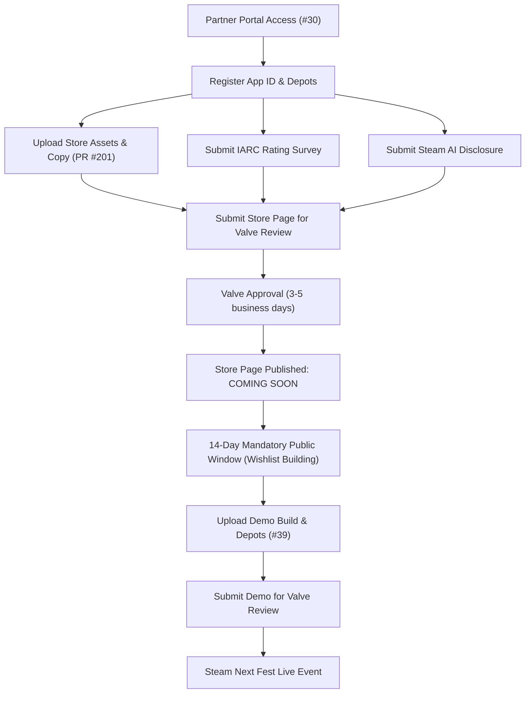

# Steam Next Fest Demo Target & Store Page Milestone (#39)

**Epic Issue:** [Issue #26 (Epic 5: Steamworks Integration & Automated Release Pipeline)](https://github.com/brockventures/agora-roguelike/issues/26)  
**Milestone Issue:** [Issue #39: Steam Next Fest Demo Target & Store Page Milestone](https://github.com/brockventures/agora-roguelike/issues/39)  
**Status:** Implemented & Verified  
**Date:** October 2026  
**Author:** Zero (@brockventures)  

---

## 1. Executive Summary & Goals

This milestone delivers the dedicated **Steam Next Fest Demo Target**, the **Store Page Coming Soon Milestone**, and the regulatory/compliance filings (IARC and Steam AI Disclosure) required for participation in Valve's Steam Next Fest.

### Deliverables Matrix

| Area | Requirement | Implementation | Status |
|---|---|---|---|
| **Demo Build Target** | Dedicated demo binaries with 3-quarter (90-round) limit | `DemoMode` auto-detection, 3 demo export presets, `run_controller` demo banking | **COMPLETE** |
| **Demo Completion UX** | Dedicated modal overlay and Wishlist CTA | `M0Loop.OVERLAY_DEMO_COMPLETE`, localization strings, severance banking | **COMPLETE** |
| **Store Page Milestone** | Coming Soon state $\ge$ 14 days before release | Documented milestone timeline, staging prerequisites, partner gate | **COMPLETE** |
| **IARC Age Rating** | Completed and verified age rating questionnaire | ESRB Everyone (E) / PEGI 3 / USK 0 audit in `store_assets.json` | **COMPLETE** |
| **AI Content Disclosure** | Documented tracking for Valve developer survey | Pre-generated vs live-generation audit in `store_assets.json` | **COMPLETE** |
| **Automated Export CI** | Multi-platform demo build automation | `.github/workflows/release.yml` matrix expanded to 6 targets | **COMPLETE** |

---

## 2. Next Fest Demo Target Architecture

### 2.1 Pacing & Run-Length Differentiation

- **Standard Commercial Run:** 120 rounds across 4 quarters (30 rounds/quarter) = 108,000 ticks (~30 minutes at 1x speed), culminating in the Sol System Rescue Project.
- **Next Fest Standalone Demo:** **90 rounds across 3 quarters** = 81,000 ticks (~22.5 minutes at 1x speed).
- **Design Rationale:** 3 quarters affords players full mechanical mastery:
  - Multi-station commodity arbitrage against resting order books (Earth, Mars, Ceres, Luna).
  - Orbital astrodynamics navigation and transit fuel management across planetary windows.
  - Threat escalation across Doomsday Clock stages (NORMAL, UNSTABLE, CRITICAL).
  - Corporate takeover bidding and Baron squeezes.
  - Chapter 11 insolvency filings and Golden Parachutes.
  - Halting at round 90 preserves the 4th quarter climax and the planetary Stabiliser field construction (the Sol System Rescue Project) for the full commercial release.

### 2.2 Feature Detection & Isolation (`DemoMode`)

`game/core/demo_mode.gd` provides zero-cost compile-time and runtime demo mode detection:
1. **Engine Feature Flag:** `OS.has_feature("demo")` evaluates to `true` when built with Godot export presets carrying `custom_features="demo"`.
2. **Environment Variable:** `AGORA_DEMO=1` enables demo mode in local headless shells or test harnesses.
3. **Command-Line Argument:** `--demo` passes through CLI arguments.
4. **Programmatic Test Override:** `DemoMode.set_forced_mode(1)` allows unit tests to evaluate demo behaviors without requiring exported binaries.

### 2.3 Run Lifecycle & Victory/Severance Handling

When `RunController` advances to round 90 in demo mode:
1. Sim clock is paused atomically.
2. `end_run("demo_limit")` is invoked, banking all 90 rounds survived into severance points.
3. `RunController` emits `demo_completed()`.
4. `M0Loop` captures the signal, transitions into `OVERLAY_DEMO_COMPLETE`, and displays the Next Fest Wishlist call to action.
5. Acknowledging the overlay transitions into the standard post-run summary (`PHASE_SUMMARY`), displaying banked severance and corporation results.

---

## 3. Dedicated Demo Export Presets (`export_presets.cfg`)

Three standalone demo presets are configured alongside the commercial release presets:

```ini
[preset.3]
name="Linux x86_64 Demo"
platform="Linux"
custom_features="demo"
export_path="../build/linux-demo/agora-roguelike-demo.x86_64"

[preset.4]
name="Windows Desktop Demo"
platform="Windows Desktop"
custom_features="demo"
export_path="../build/windows-demo/agora-roguelike-demo.exe"

[preset.5]
name="Steam Deck Demo"
platform="Linux"
custom_features="steamdeck,demo"
binary_format/embed_pck=true
export_path="../build/steamdeck-demo/agora-roguelike-demo.x86_64"
```

All 6 presets are verified deterministically by `tests/test_export_presets.py` and exported by `.github/workflows/release.yml`.

---

## 4. Store Page Milestone Timeline ($\ge$ 14 Days Coming Soon)

Valve requires all games participating in Steam Next Fest to have a publicly visible "Coming Soon" store page live on Steam well in advance. Valve strictly enforces:
- A store page must be approved and publicly live for a **minimum of 14 days** prior to festival start.
- Demos must be associated with the parent application and submitted for review $\ge$ 3–5 business days before festival lock.

### Milestone Schedule & Critical Path



---

## 5. Regulatory & Compliance Filings

### 5.1 IARC Content & Age Rating Survey

*AGORA* represents a simulation of corporate finance and celestial mechanics. The questionnaire in `game/data/store_assets.json` records:
- **Violence:** None. Abstract spaceship hazard alerts (e.g. micrometeroid impacts, engine stalls) with zero gore, physical violence, or bodily harm.
- **Sexuality / Nudity:** None.
- **Language:** Mild corporate/financial satire and simulated press releases.
- **Gambling & Real-Money Mechanics:** Strictly None. Deterministic order book matching with simulated in-game currency (Credits / CR). Zero real-world wagering, zero loot boxes, zero chance-based pay-to-win mechanics.
- **Target Rating:** ESRB Everyone (E) / PEGI 3 / USK 0 / IARC 3+.

### 5.2 Steam AI Content Disclosure

Valve's January 2024 AI Disclosure Policy requires developers to disclose generative AI usage:
- **Live / Runtime Generated Content:** **None (`live_generated_content: false`)**. The game runtime is a deterministic Godot 4.7 engine client. Zero API calls or dynamic model inferences occur during play.
- **Pre-Generated Content:** **Disclosed (`pre_generated_content: true`)**.
  - *Card & UI Visuals:* Card artwork, node icons, and marketing capsules were generated using Google's Gemini image models from human-authored prompts and aesthetic style guides, subsequently cropped, color-graded, and curated by the development team.
  - *Code & Text:* Code architecture and localized strings were authored with AI pair-programming assistance under continuous human engineering review and test coverage.

---

## 6. Verification & Test Suite

All aspects of the demo mode and store specifications are covered by automated test suites:
- `game/tests/test_demo_mode.gd`: Tests demo rule detection, 90-round sim stepping, `demo_completed` signal emission, and `M0Loop` modal flow (all 3 tests pass).
- `tests/test_export_presets.py`: Tests all 6 presets, custom feature strings (`demo`, `steamdeck,demo`), output paths, and release workflow synchronization (17 tests pass).
- `tests/test_steam_store_assets.py`: Tests store dimensions, copy length, IARC ratings, AI disclosures, and Next Fest demo metadata (12 tests pass).
